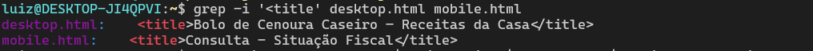
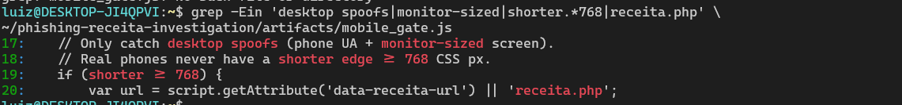
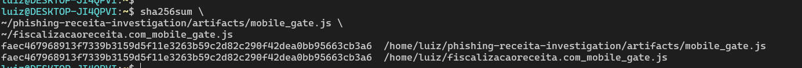

# Investigação de phishing — falsa Receita Federal

**Estudo de caso independente | Análise defensiva, OSINT e correlação de indicadores**

## Contexto

A investigação começou com um link recebido pelo WhatsApp. O endereço `analiseteibutarista.com` apresentava comportamentos diferentes conforme o dispositivo: no computador, uma página de receita de bolo; no celular, uma falsa consulta de situação fiscal, com identidade visual associada ao governo brasileiro.

O objetivo foi entender esse comportamento, reconstruir o fluxo da fraude e verificar se os artefatos encontrados apareciam em outros domínios. A análise foi feita para fins educacionais e defensivos, sem exploração de vulnerabilidades ou acesso não autorizado.

## Principais descobertas

- O servidor entregava HTML diferente para clientes desktop e mobile, comportamento compatível com **cloaking**.
- O script `mobile_gate.js` verificava também o tamanho da tela, dificultando a análise feita em computadores com User-Agent de celular.
- A página falsa encaminhava o usuário da consulta de CPF para uma suposta intimação, um chat automatizado e uma etapa de cobrança PIX.
- Uma pesquisa por hash SHA-256 no URLScan retornou **33 registros de scans** associados ao mesmo recurso. Isso não equivale a 33 operadores ou necessariamente a 33 sites distintos.
- Uma comparação mais detalhada entre `analiseteibutarista.com` e `fiscalizacaoreceita.com` mostrou reutilização de código, endpoints e outros elementos do fluxo.

As evidências permitem relacionar artefatos técnicos, **não identificar quem operava os sites**.

## Como a investigação foi conduzida

A análise combinou comparação de respostas HTTP, inspeção estática de HTML e JavaScript, consultas públicas de infraestrutura e correlação de hashes. Entre as ferramentas utilizadas estão `curl`, `dig`, `nslookup`, `whois`, `openssl`, `grep`, `sed`, `diff`, `sha256sum` e URLScan.

A sequência dos registros está em [timeline.md](timeline.md). Os [IOCs](iocs/iocs.csv), os [hashes](evidence/hashes/SHA256SUMS.txt) e os [artefatos públicos](artifacts/) ficam em arquivos separados para facilitar a consulta.

## 1. Conteúdo diferente entre desktop e mobile

A primeira diferença relevante estava na própria resposta HTTP. Ao comparar os conteúdos obtidos com perfis de cliente distintos, foram observados os seguintes títulos:

```text
Desktop: Bolo de Cenoura Caseiro – Receitas da Casa
Mobile:  Consulta - Situação Fiscal
```

Os headers coletados incluíam:

```http
Accept-CH: Sec-CH-UA-Mobile, Sec-CH-UA-Platform, Sec-CH-UA-Model
Vary: User-Agent, Sec-CH-UA-Mobile
```

Esses headers indicam que características do navegador/dispositivo eram relevantes para a resposta. A confirmação da diferença veio da comparação do HTML retornado, não apenas dos headers.



## 2. Segunda verificação: `mobile_gate.js`

A versão mobile carregava `/assets/js/mobile_gate.js`. Um trecho do script verificava as dimensões da tela:

```javascript
var w = window.screen && screen.width ? screen.width : 0;
var h = window.screen && screen.height ? screen.height : 0;
var shorter = Math.min(w, h);

if (shorter >= 768) {
    var url = script.getAttribute('data-receita-url') || 'receita.php';
    location.replace(url);
}
```

O arquivo também continha comentários sobre a detecção de computadores que simulavam um User-Agent mobile. Na prática, essa verificação podia redirecionar para a página de bolo mesmo quando o navegador se identificava como celular, caso a tela tivesse dimensões de desktop.

Isso ajuda a explicar por que alterar apenas o User-Agent não era necessariamente suficiente para visualizar o phishing.



## 3. Reconstrução do fluxo de fraude

O fluxo identificado no conteúdo e nos scripts analisados seguia aproximadamente esta sequência:

```text
Link recebido por WhatsApp
           |
           v
analiseteibutarista.com
           |
     +-----+-----+
     |           |
  Desktop      Mobile
     |           |
Página de    Falsa consulta
  bolo         fiscal / CPF
                 |
                 v
        resultado/index.php
                 |
                 v
         Suposta intimação
                 |
                 v
               /chat/
                 |
                 v
         Chat automatizado
                 |
                 v
          /pix/criar.php
                 |
                 v
          Código / QR PIX
                 |
                 v
      Consulta de status PIX
```

### Consulta de CPF e intimação

O formulário enviava dados para `resultado/index.php`, incluindo parâmetros como `cpf` e `cpf_clean`. Em um teste com CPF claramente inválido, a página retornou o status `IRREGULAR` e exibiu uma suposta intimação. Quando não havia nome associado, aparecia `Nome não informado`.

Esse comportamento mostrou que, no teste realizado, o resultado de irregularidade não dependia de uma situação fiscal verdadeira.

### Engenharia social

O conteúdo usava referências à Receita Federal, ameaças de restrição de movimentações financeiras e uma multa de **R$ 1.985,00**. Um chat automatizado em JavaScript apresentava uma suposta auditora chamada **Tereza Alencar**, oferecia desconto de **67%** e incluía a opção **“Autorizo o bloqueio do meu CPF”**.

Esses elementos combinavam autoridade aparente, urgência e pressão para conduzir a vítima ao pagamento.

### Fluxo PIX observado no código

O frontend preparava um `POST` JSON para `/pix/criar.php`, com campos como `name`, `email`, `cpf`, `phone`, `parcelasSelecionadas`, `quantidadeParcelas` e `valorTotal`.

O código tratava respostas com nomes de campos como `pixCode`, `pix_code`, `pixQrCode`, `pix_qr_code`, `id` e `transaction_id`. Também havia consultas de status em:

```text
/pix/detalhes.php?id=<transactionId>
/pix/status.php?transactionId=<transactionId>
```

Foram identificados os estados `approved`, `paid` e `processing`. **Nenhuma cobrança PIX foi criada durante a investigação.** A descrição acima se baseia no fluxo encontrado no código, não na confirmação de uma transação real.

## 4. Infraestrutura observada

Na coleta inicial, foram registrados os seguintes dados para `analiseteibutarista.com`:

| Indicador | Valor observado |
|---|---|
| IPv4 | `185.190.143.246` |
| Provedor / ASN | Contabo GmbH / AS51167 |
| Servidor HTTP | `nginx/1.18.0 (Ubuntu)` |
| Registrar | Tucows Domains Inc. |
| Nameservers | `1-you.njalla.no`, `2-can.njalla.in`, `3-get.njalla.fo` |
| Certificado TLS | Let's Encrypt |

Também foi observado um registro TXT de verificação do Google. As informações representam **o momento da coleta**; IPs, DNS e certificados podem mudar posteriormente.

Foram consultados dados de DNS, WHOIS, headers HTTP e certificado TLS, incluindo emissor, sujeito, validade e número de série. Nem todos os artefatos brutos foram publicados neste repositório.

## 5. Correlação pelo URLScan

Ao pesquisar o SHA-256 de um recurso associado ao phishing, a busca no URLScan retornou **33 scans** com o mesmo hash. Entre os domínios listados nos resultados estavam:

```text
controlefiscalbr.com
regularizafiscalbr.com
regularizapendencia.com
fiscalcerto.com
fiscalizacaoreceita.com
ordemtributos.com
regularidadepessoal.com
acertatributos.com
acertoguiadeclara.com
atividaderegular.com
fiscalregulariza.com
acessorestricaofiscal.com
conformidadeemdia.com
fiscalcontrole.com
tributosconformes.com
fiscalconforme.com
controledadosfiscal.com
regularizetributos.com
conformidadetributos.com
conformidaderegular.com
segurocartorio.com
```

O hash idêntico comprova que o **recurso consultado** era igual nos registros correspondentes. Não comprova, por si só, que todos os domínios eram controlados pela mesma pessoa ou grupo.

### Comparação com `fiscalizacaoreceita.com`

Esse domínio mereceu uma análise mais detalhada porque apresentava diversas semelhanças com o primeiro: mesmo `mobile_gate.js`, comentários de código, lógica de redirecionamento, personagem do chat, valor de multa, percentual de desconto, estrutura de endpoints e fluxo PIX. Também foram observadas semelhanças de registrar, nameservers e provedor/ASN.

O SHA-256 do `mobile_gate.js` era idêntico nos dois domínios:

```text
faec467968913f7339b3159d5f11e3263b59c2d82c290f42dea0bb95663cb3a6
```



Os caminhos encontrados incluíam:

```text
/
receita.php
chat/
resultado/index.php
pix/criar.php
pix/detalhes.php
pix/status.php
assets/js/mobile_gate.js
```

A combinação desses elementos sustenta a conclusão de **reutilização de uma mesma base de phishing ou de componentes compartilhados**. Não é suficiente para atribuir autoria: um mesmo kit pode circular entre operadores diferentes.

## 6. Indicadores e evidências

Alguns indicadores documentados:

```text
analiseteibutarista.com
fiscalizacaoreceita.com
185.190.143.246
searchapi.dnnl.live
```

O endereço `searchapi.dnnl.live` apareceu em um comentário de código que mencionava uma API para consulta de CPF. Durante a análise, `searchapi.dnnl.live` e `dnnl.live` retornavam `NXDOMAIN`; portanto, o domínio foi registrado como **possível referência histórica ou desativada**, não como serviço comprovadamente ativo.

Para consulta dos registros publicados:

- [Lista de IOCs](iocs/iocs.csv)
- [Hashes SHA-256](evidence/hashes/SHA256SUMS.txt)
- [Artefatos disponibilizados](artifacts/)
- [Capturas de tela](screenshots/)
- [Linha do tempo](timeline.md)

Os materiais públicos são uma seleção das evidências. Arquivos originais e informações sensíveis não são necessariamente publicados na íntegra.

## Estrutura do repositório

```text
phishing-investigation-case-study/
├── README.md
├── timeline.md
├── .gitignore
├── artifacts/
├── evidence/
│   └── hashes/
│       └── SHA256SUMS.txt
├── iocs/
│   └── iocs.csv
└── screenshots/
    ├── desktop-vs-mobile-title.png
    ├── mobile-gate-anti-analysis.png
    └── identical-mobile-gate-hash.png
```

A árvore mostra os principais arquivos referenciados neste documento, sem representar a lista completa de todos os artefatos de cada pasta.

## Limites da investigação

- Os dados de infraestrutura são registros pontuais, não garantias de que os serviços ainda estejam ativos.
- O compartilhamento de código, hash, hospedagem ou configuração não identifica o operador da campanha.
- A análise do fluxo PIX foi estática; não houve geração de cobrança nem confirmação de pagamento.
- Não foram realizadas exploração de vulnerabilidades, força bruta, enumeração de CPFs, acesso administrativo ou varreduras agressivas.
- CPFs reais, credenciais, tokens e outros dados sensíveis não foram incluídos na documentação pública.

## Conclusão

A investigação começou com uma diferença de comportamento entre desktop e celular. A comparação das respostas HTTP levou à análise do `mobile_gate.js`; depois, a inspeção do conteúdo e dos scripts permitiu reconstruir o caminho da falsa consulta fiscal até o pagamento PIX. Por fim, a comparação de hashes e outros artefatos revelou relações técnicas com domínios adicionais.

O principal resultado foi documentar **como a página ocultava o conteúdo de phishing e como componentes da mesma base apareciam em outros endereços**. A autoria e a extensão completa da operação permanecem desconhecidas.

Este estudo de caso registra uma investigação independente de segurança defensiva. Os domínios e indicadores são apresentados como evidência histórica, não como destinos para acesso ou interação.
